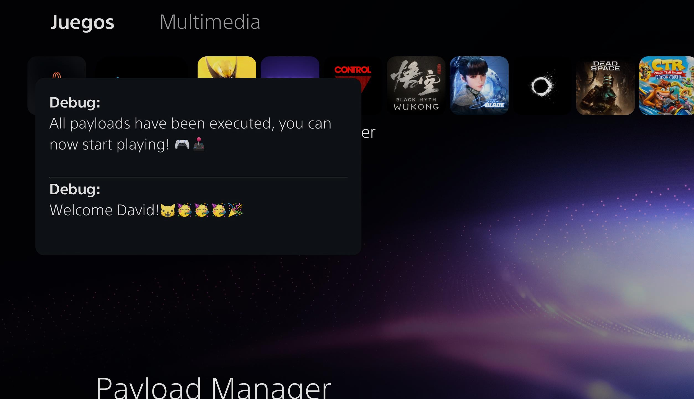
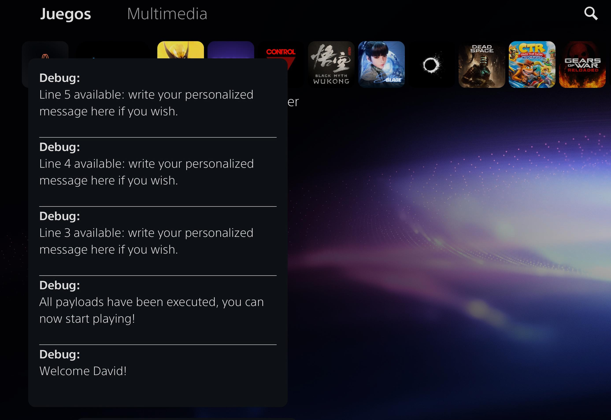
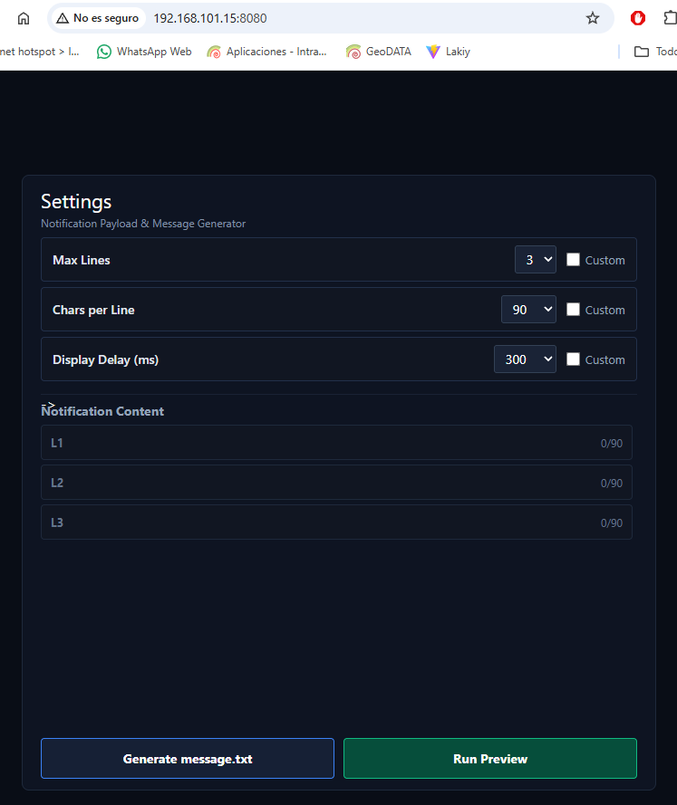
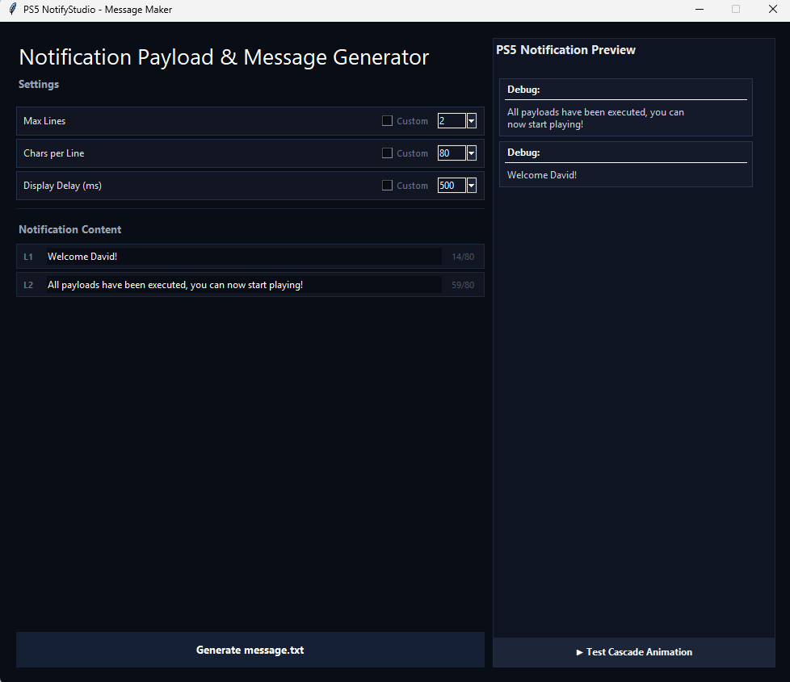

# Ps5-custom-notifications

A lightweight C-based payload for PlayStation 5 consoles that reads a local `message.txt` file and displays its lines as native system notifications.

<p align="center">
  
  <br>
  <em>Two-line demonstration</em>
</p>

## 🚀 Features

* **Smart Search Hierarchy:** Scans external USB ports (`usb0` through `usb7`) first, stopping at the first found `message.txt`. If none are found, it falls back to internal storage (`/data/ps5_autoloader/message.txt`).
* **Clean Formatting & Limits:** Automatically omits blank lines, Use the settings in the message.txt file to display the desired number of lines, being able to adjust the number of characters and delay between notifications. 
* **Multilingual Error Handling:** Fully supports 31 PS5 system languages for error notifications if the file cannot be located.
* **Silent Execution:** No progress or search notifications are shown before displaying the actual message lines.

>## ⚠️ Limitations
>
>To ensure system stability and a smooth user experience within the PS5 notification daemon, the payload enforces the following rules:
>
>* **Lines:** Only non-empty lines of the `message.txt` file are processed and displayed as individual pop-up notifications. Any subsequent lines are ignored.
>* **Max 90 Characters per Line:** Lines longer than 90 characters are automatically truncated at 86 characters and appended with `...` to prevent UI overflow or notification formatting glitches.
>* **If a line contains spaces** (without having any text characters), it can be taken as not empty, and if it is within the first five lines, then it will display an empty notification on the screen.

<p align="center">
  
  <br>
  <em>Five-line demonstration</em>
</p>

## 🛠️ Build Requirements

* PS5 Payload SDK
* `prospero-clang` toolchain in a Linux environment (Ubuntu / WSL)

To build the project, run:

```bash
make clean && make
```

## 📖 Instructions for Use

1. **Prepare your message file manually:**
* Create a text file named `message.txt` containing the lines you want to display. The structure is as follows:

```bash
LINES=2
CHARS=80
DELAY=500
---
Welcome David!
All payloads have been executed, you can now start playing!
```
Where
  LINES: number of lines, 
  CHARS: number of characters per line, 
  DELAY: delay between notifications in microseconds

* Place it either in `/data/ps5_autoloader/` on the console's internal storage, or inside a `ps5_autoloader` folder on the root of an exFAT/FAT32 USB drive.

2. **Prepare your message file on your PS5:**

* **message_maker.elf**: Open the PS5's web browser to create a `message.txt` file. There you can configure options such as the number of lines, characters per line, and the delay between notifications. You can also preview the notifications. You can also view this application on your PC connected to the same network at `http://<your-ps5-ip>:8080`

<p align="center">
  
  <br>
  <em>message_maker interface</em>
</p>

3. **Prepare your message file on your PC:**

* **PS5 NotifyStudio.exe** : Windows application with an interface to create the message.txt file where you can configure all the options such as number of lines, characters per line and delay between notifications, and you can also see a preview of the notifications.

<p align="center">
  
  <br>
  <em>PS5 NotifyStudio interface</em>
</p>


4. **Run the Payload:**
* Inject or launch `ps5_notify.elf` on your PS5 using your preferred payload loader.

## 🤖 Credits

* Developed with the assistance of **Google Gemini** and **ChatGPT**.
* Based on foundational tools and payload structures by John Törnblom.
* Thanks to **Drakmor** and the **ShadowMountPlus** project for providing a reference for the PS5 system language
detection implementation used in this project.

